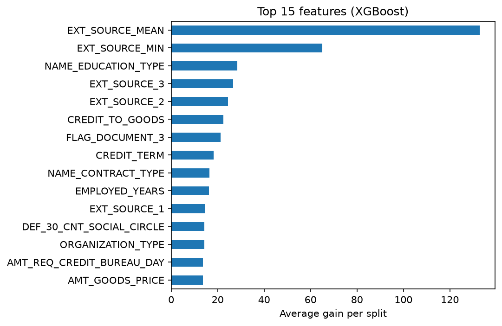

# Credit Default Risk Model

Predicting the probability that a loan applicant defaults, using Home Credit's application data (246,000 real consumer loans). Built step by step from an explainable baseline to a calibrated XGBoost model with a cost-based approval policy, then deployed as an API.

## Results

| Model | Test ROC AUC | Gini |
|---|---|---|
| Logistic regression (baseline) | 0.747 | 0.495 |
| **XGBoost (gender excluded)** | **0.761** | **0.521** |

**Approval policy:** approving applicants with predicted default risk below 16% approves **89% of applicants** and cuts the **default rate among approved loans from 8.0% to 5.8%**. Rejecting the riskiest 11% removes about a third of all defaults.

<p>
  
  
  
</p>

## Approach

1. **Data cleaning:** `DAYS_EMPLOYED = 365243` is a placeholder for pensioners and unemployed applicants (18% of rows). Treated it as missing and kept a flag, since that group defaults less (5.3% vs 8.6%).
2. **Feature engineering:** affordability ratios lenders use (credit/income, annuity/income, loan term), `CREDIT_TO_GOODS` (borrowing more than the item costs), and the mean and minimum of the external credit-bureau scores. Engineered features are the top-ranked and sixth-ranked features in the final model.
3. **Fairness:** gender was a strong coefficient in the baseline. Removed it, since many lenders and regulators do not allow it in credit decisions. The final model is more accurate without it.
4. **Validation:** a fixed 20% test set shared by both models, so the comparison is like for like. A separate validation split is used for early stopping, calibration and threshold choice; the test set is used once.
5. **Calibration:** tested isotonic calibration. It did not improve the Brier score (0.0673 raw vs 0.0673 calibrated) because XGBoost trained on log-loss was already well calibrated, so the raw probabilities are used.
6. **Approval threshold:** chosen to minimise expected cost, assuming approving a defaulter costs 5× rejecting a good customer. A real lender would plug in its own loss-given-default and margin.



## Progress
- [x] Step 1: Cleaning, lender-style features, logistic regression baseline
- [x] Step 2: XGBoost, calibration, cost-based approval threshold
- [ ] Step 3: Explainability (per-applicant reason codes with SHAP)
- [ ] Step 4: FastAPI service in Docker, deployed on AWS Lambda
- [ ] Step 5: Next.js front end on Vercel

## Run it
```
python -m venv .venv
.venv\Scripts\activate          # Windows  (Mac/Linux: source .venv/bin/activate)
pip install -r requirements.txt
jupyter notebook
```
Run `01_baseline.ipynb`, then `02_xgboost.ipynb`. Shared preprocessing lives in `features.py`.

**Data:** `application_train.csv` from the Kaggle competition [Home Credit Default Risk](https://www.kaggle.com/c/home-credit-default-risk), placed in `data/` (not committed). This run used a 246,008-row copy (about 80% of the official 307,511-row training file).
