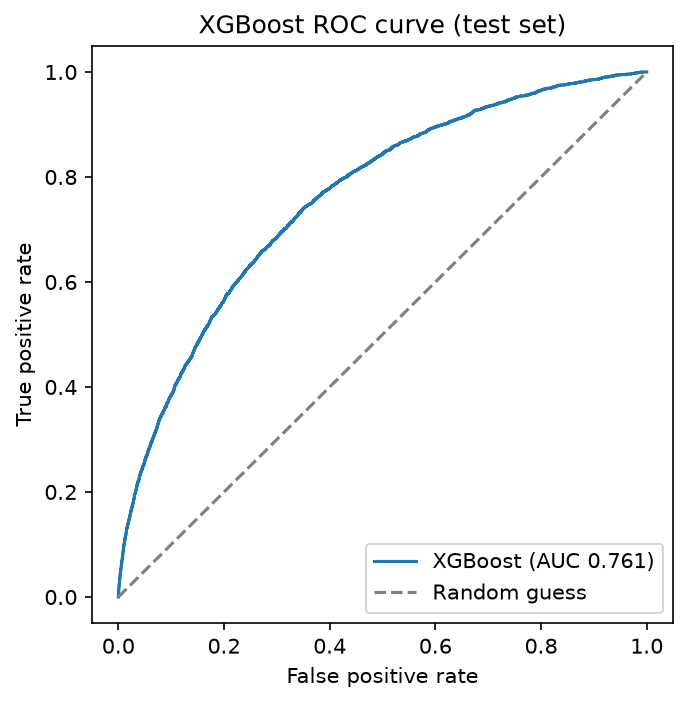
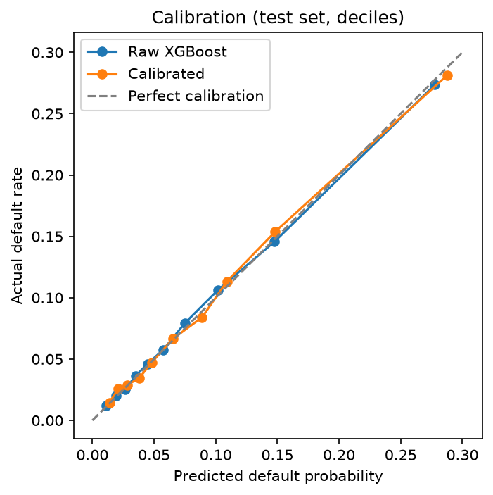
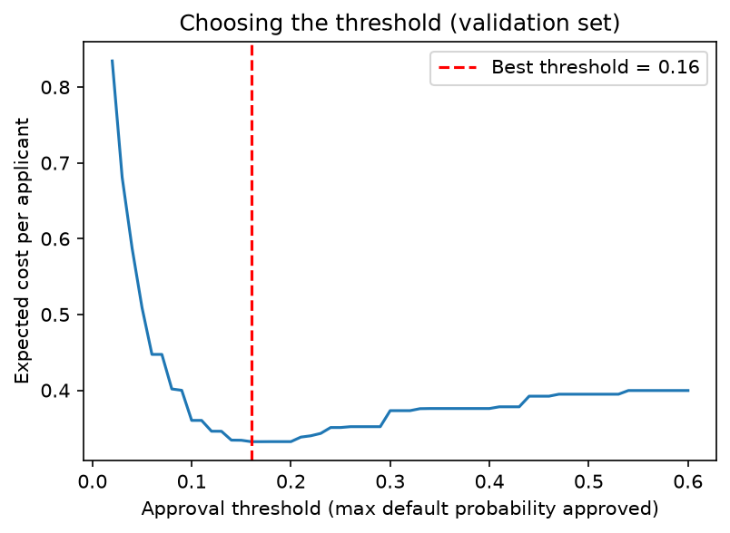
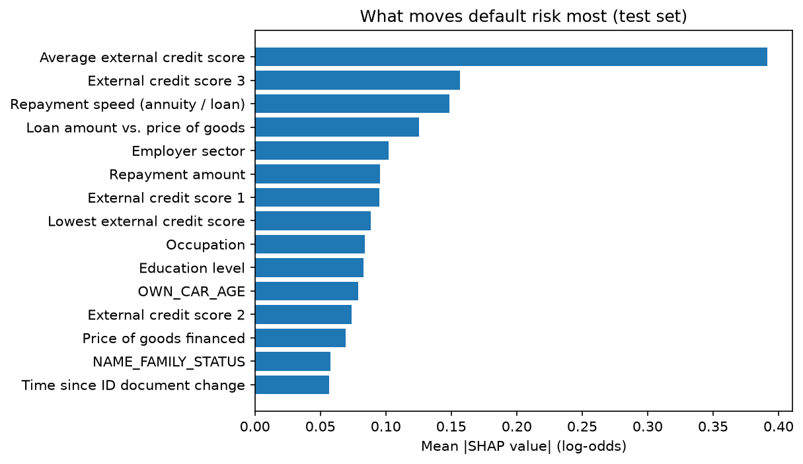
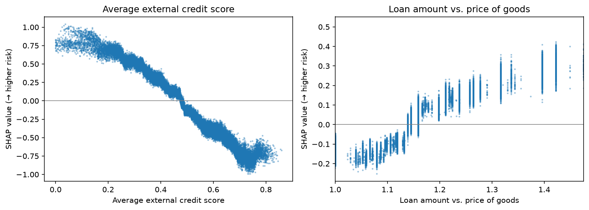
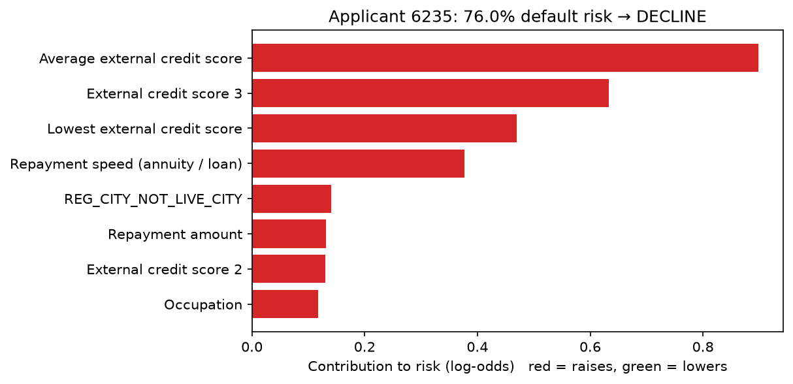

# Credit Default Risk Model

**Live demo:** [https://qkzbx4mcxc3ctnvvytzbrwl4ku0qhpwg.lambda-url.ap-southeast-2.on.aws/](https://qkzbx4mcxc3ctnvvytzbrwl4ku0qhpwg.lambda-url.ap-southeast-2.on.aws/) (AWS Lambda; the first load can take a few seconds)

Predicting the probability that a loan applicant defaults, using Home Credit's application data (246,000 real consumer loans). Built step by step from an explainable baseline to an XGBoost model with a cost-based approval policy, per-applicant reason codes, and a fairer 17-input deployment model served as a live web app on AWS Lambda.

## Results

| Model | Test ROC AUC | Gini |
|---|---|---|
| Logistic regression (baseline) | 0.747 | 0.495 |
| XGBoost, full (~130 columns, gender excluded) | 0.761 | 0.521 |
| **XGBoost, deployment (17 inputs; gender, marital status, age, application timing excluded)** | **0.758** | **0.516** |

**Approval policy (deployment model):** approving applicants with predicted default risk below 17% approves **88% of applicants** and cuts the **default rate among approved loans from 8.0% to 5.7%**.

<p>
  
  
  
</p>

## Approach

1. **Data cleaning:** `DAYS_EMPLOYED = 365243` is a placeholder for pensioners and unemployed applicants (18% of rows). Treated it as missing and kept a flag, since that group defaults less (5.3% vs 8.6%).
2. **Feature engineering:** affordability ratios lenders use (credit/income, annuity/income, loan term), `CREDIT_TO_GOODS` (borrowing more than the item costs), and the mean and minimum of the external credit-bureau scores. Three of the top four features by SHAP are engineered (see below).
3. **Fairness:** gender was a strong coefficient in the baseline. Removed it, since many lenders and regulators do not allow it in credit decisions. The final model is more accurate without it.
4. **Validation:** a fixed 20% test set shared by both models, so the comparison is like for like. A separate validation split is used for early stopping, calibration and threshold choice; the test set is used once.
5. **Calibration:** tested isotonic calibration. It did not improve the Brier score (0.0673 raw vs 0.0673 calibrated) because XGBoost trained on log-loss was already well calibrated, so the raw probabilities are used.
6. **Approval threshold:** chosen to minimise expected cost, assuming approving a defaulter costs 5× rejecting a good customer. A real lender would plug in its own loss-given-default and margin.
7. **Explainability (SHAP):** XGBoost's native SHAP values give each applicant's prediction as a sum of feature contributions, checked to add up exactly to the model output. Engineered features rank 1st, 3rd and 4th. Risk falls steadily as the external credit score rises, and climbs once the loan exceeds the goods price by about 15%.
8. **Fixing what the explanations revealed:** reason codes showed the model using the application weekday and marital status. The deployment model removes both, plus age, and keeps only 17 inputs an applicant could enter in a form, at a cost of just 0.004 AUC.
9. **API and deployment:** FastAPI service returning the default probability, the decision and the top reasons that raised and lowered risk. Inputs are validated against a form spec saved with the model, and a round-trip test confirms the API path reproduces the notebook's predictions exactly. Deployed on AWS Lambda as a zip package plus a dependency layer (XGBoost, pandas, FastAPI via Mangum), with a Function URL serving both the web form and the JSON API.
10. **Known limitation:** tree models do not extrapolate, so extreme inputs far outside the training data (e.g. a loan of 20× income with strong credit scores) can still score as low risk. A production system would add hard policy rules (affordability caps) in front of the model.

<p>
  
  
</p>


## Progress
- [x] Step 1: Cleaning, lender-style features, logistic regression baseline
- [x] Step 2: XGBoost, calibration, cost-based approval threshold
- [x] Step 3: Explainability (per-applicant reason codes with SHAP)
- [x] Step 4a: Fairer 17-input deployment model
- [x] Step 4b: FastAPI service with reason codes
- [x] Step 4c: Deployed on AWS Lambda (zip + layer, Function URL)
- [x] Step 5: Web front end served by the API
- [ ] Next: affordability policy rules in front of the model

## Run it
```
python -m venv .venv
.venv\Scripts\activate          # Windows  (Mac/Linux: source .venv/bin/activate)
pip install -r requirements.txt
jupyter notebook
```
Run the notebooks in order: `01_baseline`, `02_xgboost`, `03_explain`, `04_deploy_model`. Shared preprocessing lives in `features.py`.

**API locally:**
```
pip install fastapi uvicorn mangum
uvicorn api.app:app --reload
```
Then open `http://127.0.0.1:8000` for the web form or `/docs` for the API. Endpoints: `GET /`, `GET /health`, `GET /schema`, `POST /predict`.

**Deploy to AWS Lambda:** train `04_deploy_model` with `xgboost==3.0.5` (the version in the Lambda layer, see `api/requirements-api.txt`), run `build_lambda_zip.ps1` to create `function.zip`, upload it to a Python 3.12 x86_64 function with the dependency layer attached, and enable a public Function URL.

**Data:** `application_train.csv` from the Kaggle competition [Home Credit Default Risk](https://www.kaggle.com/c/home-credit-default-risk), placed in `data/` (not committed). This run used a 246,008-row copy (about 80% of the official 307,511-row training file).
